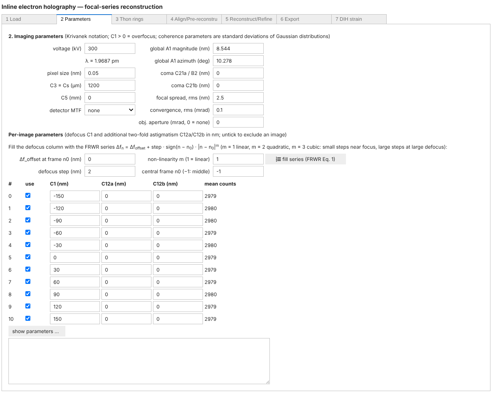
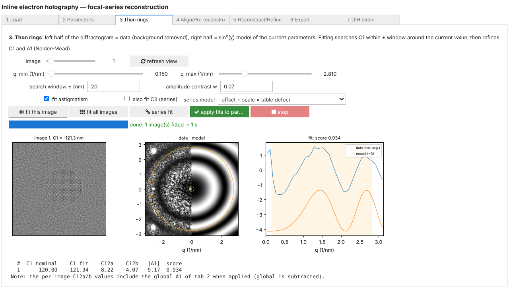
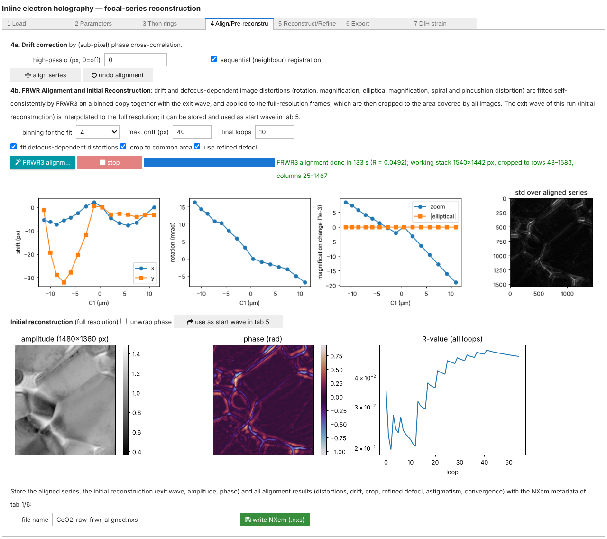
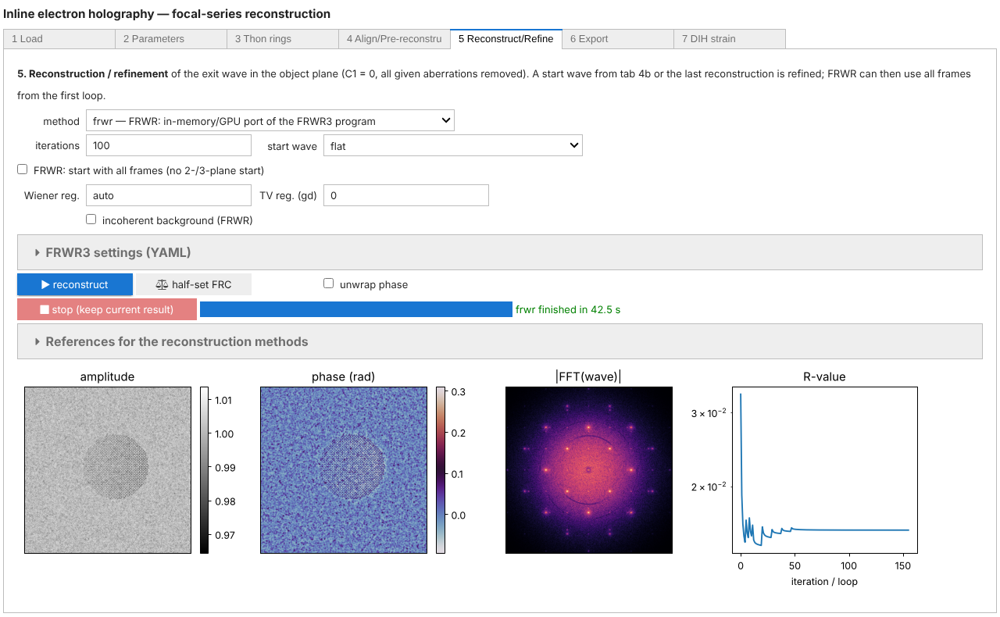
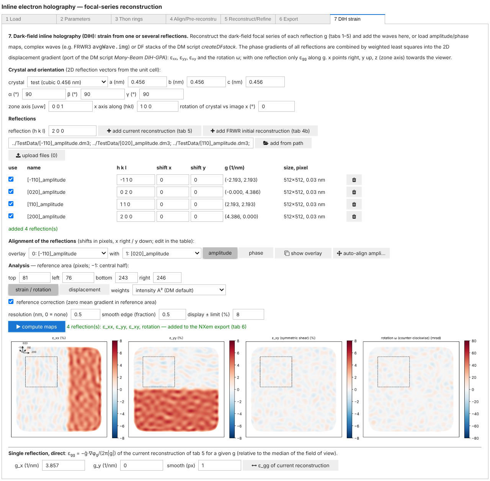
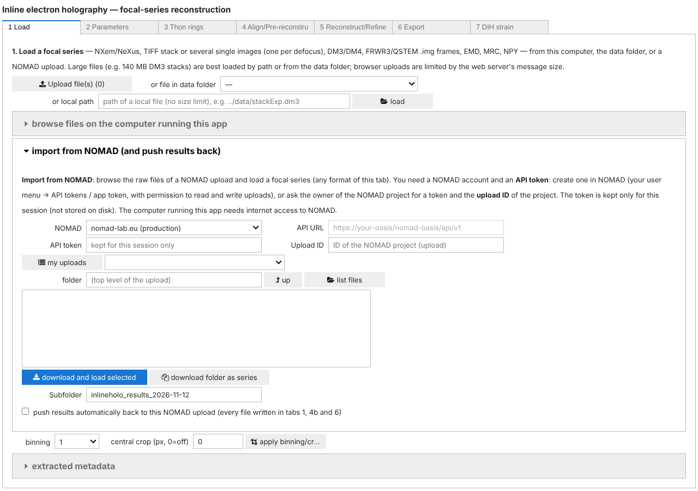

# inlineHolo — inline electron holography

Reconstruction of the electron exit wave (amplitude and phase) from a **focal series** of TEM images,
with a browser-based app that guides through the whole workflow: loading data, fitting the imaging
parameters, aligning the series, reconstructing, analysing strain by dark-field inline holography,
and exporting FAIR data in the NeXus/**NXem** format.

* **Reconstruction methods** – transport-of-intensity equation (TIE, higher-order, Fokker–Planck,
  multi-focus MFTIE, gradient-flipping GF-TIE), parabola method, Schiske filter, Gerchberg–Saxton,
  IWFR, maximum likelihood (MAL, Poisson), and **FRWR3** (full-resolution wave reconstruction),
  ported loop by loop from the C++ program to Python with NumPy/CuPy/PyTorch (GPU) back ends.
* **FRWR alignment and initial reconstruction** – drift and defocus-dependent image distortions
  (rotation, magnification, elliptical, spiral, pincushion) are fitted together with the wave; the
  wave is the start for refinement with all frames.
* **Thon-ring fitting** of defocus, two-fold astigmatism and C3, per image or for the whole series
  (linear or non-linear defocus series, FRWR Eq. 1).
* **Dark-field inline holography (DIH)** – strain, shear and rotation maps (or displacement) from one or
  several reflections (port of the DigitalMicrograph *Many-Beam DIH-GPA* scripts).
* **Data** – NXem/NeXus, DM3/DM4 (with FRWR tags), FRWR3/QSTEM `.img` series, TIFF, EMD, MRC, NPY;
  NXem export validated with `pynxtools`; import from and upload to **NOMAD**.
* Long computations run in the background with progress, remaining time and a stop button.
* **NOMAD plugin** – the app as a NOMAD **dashboard** (with the user's NOMAD login) and the reconstruction as a
  NOMAD **action** on a worker, results added to the upload as NXem; a **batch action** spreads many series
  over CPU (alignment) and GPU (reconstruction) workers via NOMAD's Temporal workflow engine
  ([docs/NOMAD_PLUGIN.md](docs/NOMAD_PLUGIN.md)).

## Screenshots

| | |
|---|---|
|  |  |
| **2 Parameters** – imaging parameters and per-image defocus (FRWR Eq. 1 series) | **3 Thon rings** – data (left) vs. model (right), radial profiles, fitted C1 and A1 |
|  |  |
| **4b FRWR alignment** – drift, rotation and magnification vs. defocus of a raw CeO₂ series, initial reconstruction at full resolution | **5 Reconstruct/Refine** – FRWR exit wave of a simulated series, with progress and stop |
|  |  |
| **7 DIH strain** – ε<sub>xx</sub>, ε<sub>yy</sub>, ε<sub>xy</sub>, rotation from four reflections | **1 Load** – local files, file browser or a NOMAD upload; results can be pushed back |

## Quick start

```bash
pip install -e ".[web,nexus]"              # or: pip install -r requirements.txt
pip install pynxtools pynxtools-em          # optional: NXem validation

# the app in the browser, without Jupyter
pip install "solara==1.58.2" "solara-assets==1.58.2"
solara run webapp/solara_app.py             # http://localhost:8765

# or as a Voilà / Jupyter app
voila notebooks/02_inline_holography_app.ipynb

# or as a container (also the basis of a Galaxy Interactive Tool, see galaxy/)
docker build -t inlineholo-web -f galaxy/Dockerfile .
docker run -p 8765:8765 inlineholo-web
```

In NOMAD (e.g. [nomad-distro-dev](https://github.com/FAIRmat-NFDI/nomad-distro-dev)):

```bash
git submodule add https://github.com/christophys/inlineHolo.git packages/inlineHolo
uv add packages/inlineHolo --extra nomad
uv run poe start        # dashboard: http://localhost:8000/nomad-oasis/dashboards/inlineholo/
uv run poe cpuworker    # runs the actions (single series, batch)
uv run poe gpuworker    # optional: GPU reconstructions of the batch action
```

From Python:

```python
import inlineholo as ih
stack, params, _, _ = ih.nxem.read_focal_series("data/hr_focal_series_sim.nxs")
rec = ih.reconstruct(stack, params, "frwr", n_iter=50)          # also "tie", "gpfrwr", "mal", ...
out, info = ih.align.frwr3_align(raw_stack, params, binning=2)  # FRWR alignment of a raw series
```

`data/` holds simulated focal series (high, medium resolution and DIH; NXem with ground truth).
`notebooks/01_method_comparison.ipynb` compares all methods quantitatively; `tests/` (pytest) covers the
methods, the FRWR3 port against the C++ program, NXem validity, the app and the NOMAD client.

## Repository layout

```
inlineholo/        Python package (reconstruction, FRWR3 port, alignment, Thon fit, DIH, NXem, NOMAD, app)
inlineholo_nomad/  NOMAD plugin: dashboard (the app inside NOMAD) and action (reconstruction on a worker)
webapp/            stand-alone web app (Solara)
galaxy/            Dockerfile and draft Galaxy Interactive Tool
notebooks/         00 download a repository, 01 method comparison, 02 the app (Voilà)
data/, results/    simulated test data, benchmark tables
examples/          FRWR3 control files (.conf / YAML with all keys)
frwr3_cpp_patches/ patch and build notes for the C++ FRWR3 on Linux
tests/             pytest suite
docs/              detailed documentation (DETAILS.md) and screenshots
```

See [docs/DETAILS.md](docs/DETAILS.md) for conventions, the FRWR3 interface, NXem layout, DM3/`.img`
input, DIH, NOMAD and the remaining-time estimates.

## References

The literature for each reconstruction method (with DOIs) is listed in the app (tab 5) and in
`inlineholo/references.py`. FRWR: C. T. Koch, *Ultramicroscopy* 108, 141 (2008),
[doi:10.1016/j.ultramic.2007.03.007](https://doi.org/10.1016/j.ultramic.2007.03.007);
C. T. Koch, *Micron* 63, 69 (2014), [doi:10.1016/j.micron.2013.10.009](https://doi.org/10.1016/j.micron.2013.10.009).

## License

BSD 3-Clause License, © 2008–2026 Christoph T. Koch — see [LICENSE](LICENSE).
