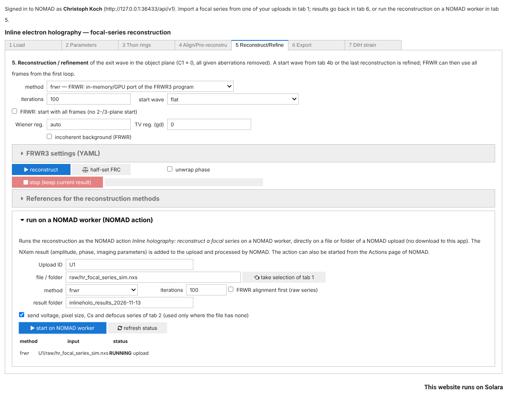

# inlineHolo as a NOMAD plugin (dashboard + action)

The repository is also a NOMAD plugin (package `inlineholo_nomad`, entry points in `pyproject.toml`):

| entry point | type | what it does |
|---|---|---|
| `inlineholo_nomad.dashboards:inlineholo_dashboard` | dashboard | the inline-holography app (the same GUI as the Voilà / Solara app) inside NOMAD, at `{api_base_path}/dashboards/inlineholo/` |
| `inlineholo_nomad.actions:inlineholo_reconstruction` | action | reconstruction of a focal series of a NOMAD upload on a NOMAD worker; the NXem result is added to the upload |
| `inlineholo_nomad.actions:inlineholo_batch` | action | several series in parallel, coordinated by Temporal: alignment on CPU workers, optional approval, reconstruction on GPU workers (CPU fallback) |

Both need the new NOMAD GUI and NOMAD ≥ 2.0 (dashboard and action entry points).

## Installation in nomad-distro-dev

```bash
cd nomad-distro-dev
git submodule add https://github.com/christophys/inlineHolo.git packages/inlineHolo
uv add "./packages/inlineHolo[nomad]"      # or: uv add packages/inlineHolo  plus  uv pip install solara solara-assets
uv sync
docker compose up -d                       # infrastructure (MongoDB, Elasticsearch, Temporal, ...)
uv run poe setup                           # first time only
uv run poe start                           # NOMAD API + new GUI (one FastAPI worker)
uv run poe cpuworker                       # in a second terminal: CPU worker that runs the actions
uv run poe gpuworker                       # optional, on a machine with a GPU: reconstructions of the batch action
```

* **Dashboard:** new GUI (http://localhost:8000/nomad-oasis/gui/v2/) → *Dashboards* → *Inline holography*
  (embedded or in a new tab). Directly: http://localhost:8000/nomad-oasis/dashboards/inlineholo/
* **Action:** new GUI → *Actions* → *Inline holography: reconstruct a focal series* (form with upload ID, file or
  folder, method, iterations, optional FRWR alignment and imaging parameters), or from the dashboard: tab 5 →
  *run on a NOMAD worker*, or via the API:

  ```bash
  curl -X POST -H "Authorization: Bearer $TOKEN" -H "Content-Type: application/json" \
       http://localhost:8000/nomad-oasis/api/v1/actions/inlineholo_nomad.actions:inlineholo_reconstruction/start \
       -d '{"data": {"upload_id": "<upload id>", "path": "raw/series.dm3", "method": "frwr", "n_iter": 50}}'
  ```

  The result (`<input>_<method>.nxs` in the folder `inlineholo_results` of the upload) contains the focal
  series, the imaging parameters and the exit wave (amplitude and phase) and is processed by NOMAD as an NXem
  entry (with pynxtools). Only authors and co-authors of an unpublished upload can run the action on it.



*The dashboard served by the NOMAD app (`/nomad-oasis/dashboards/inlineholo/`): signed in with the NOMAD login,
focal series imported from an upload, reconstruction started on a NOMAD worker (tab 5).*

## Batch action: several workers coordinated by Temporal

NOMAD actions are Temporal workflows. The batch action uses this to spread the work over the workers:

```
BatchReconstructWorkflow                                  (CPU queue; the action instance)
 ├─ plan_batch                                 CPU        series of the given files / folders
 ├─ PrepareSeriesWorkflow  ×N (≤ max_parallel) CPU        copy out of the upload, load, FRWR alignment
 ├─ [approval]   request_signal_input_activity → waits for the signal approve_alignment
 ├─ ReconstructSeriesWorkflow ×M               GPU queue  reconstruction (CuPy/PyTorch if available);
 │                                             └ CPU      if no GPU worker takes it within gpu_wait_minutes
 │   └─ write_series_result                    CPU        NXem → upload (output folder)
 └─ finish_batch                               CPU        batch_summary_<time>.json → upload
```

* **Queues:** the workflows and the CPU activities run on `cpu-task-queue`; `reconstruct_series` is
  registered on both queues (`task_queue_activities` of the action), so a GPU worker
  (`uv run poe gpuworker`) takes the reconstructions, and without one they fall back to the CPU queue
  after `gpu_wait_minutes`.
* **Data between workers:** only paths and small records go through Temporal; the arrays are written to
  the working folder of the action instance (NOMAD's `action_instance_artifacts_dir`). Workers on other
  machines need this folder (NOMAD's `fs` volume) mounted at the same path. The folders are removed at the
  end, also after cancellation or failure.
* **Approval (human in the loop):** with `approve_alignment` the action stops after the alignment and asks
  for approval (table of the series with R value and drift), in the dashboard (tab 5, batch section: *approve
  all* / *approve these*) or on NOMAD's Actions page. Without an answer within `approval_timeout_hours`
  nothing is reconstructed.
* **Robustness:** a series that cannot be read or aligned is reported and skipped; the others continue. Long
  activities heartbeat every few seconds (also during a long FRWR loop), so a crashed worker is noticed after
  30 s and the work is retried once on another worker; cancelling the action interrupts the running
  reconstruction within seconds.
* **Result:** one NXem file per series (aligned series, FRWR alignment wave, exit wave) in the output folder
  of the upload, and a JSON summary (status, R values, which queue did the reconstruction).

The workflow code (`inlineholo_nomad/workflows/`) does not import NOMAD at module level, as Temporal
re-imports workflow modules in its sandbox; NOMAD is only used inside the activities (`backend.py`).

## How the dashboard works

NOMAD calls `load()` of the dashboard entry point once at start-up and mounts the returned FastAPI app. That
app is the **Solara** server of the app (`inlineholo_nomad/dashboards/server.py`); Solara renders the
ipywidgets GUI of `inlineholo.app.App` in the browser and keeps one App per browser session in the NOMAD app
process (`inlineholo_nomad/dashboards/page.py`):

* **NOMAD login:** the browser sends the `Authorization` cookie of the NOMAD GUI to the dashboard (same origin).
  The page uses it for the NOMAD import (tab 1) and export (tab 6): *this NOMAD* is preselected, the uploads of
  the user are listed, no API token is needed. The GUI token expires after some time; then reload the
  dashboard (or paste an app token in tab 1).
* **Server mode:** the app cannot read or write the server's files (no local path / file browser in tabs 1
  and 7); each session has its own working folder, deleted when the session ends; data come from NOMAD
  uploads or browser uploads.
* **Computations** of the dashboard run in threads of the NOMAD app process (as in the stand-alone app, with
  progress and stop buttons). Long reconstructions are better sent to a worker with the action.

### Limits and options

* Solara keeps the session state in the process that served the page: the NOMAD app must run with **one
  FastAPI worker** (as `uv run poe start` / `nomad admin run appworker --dev` does) or behind a proxy with
  sticky sessions.
* For production Oases with several app workers, run the app separately (the container of
  `galaxy/Dockerfile`) and set `INLINEHOLO_DASHBOARD_URL` in the environment of the NOMAD app: the dashboard
  then only links/iframes that URL (`external_url`). The NOMAD login is not passed on in that case (use an
  API token in tab 1).
* Embedding in a GUI served from another origin (e.g. the GUI dev server on port 3000) needs
  `dashboards.frame_ancestors` in `nomad.yaml`:

  ```yaml
  dashboards:
    frame_ancestors: ["'self'", "http://localhost:3000"]
  ```

* Environment variables: `INLINEHOLO_DATA` (read-only example data shown in tab 1), `INLINEHOLO_NOMAD_API`
  (API URL the dashboard uses to reach NOMAD, default: derived from the request / the NOMAD config).
* The action runs on the CPU task queue. The FRWR methods can use a GPU (CuPy/PyTorch back ends); for a GPU
  worker set `task_queue: gpu-task-queue` for the entry point in `nomad.yaml`
  (`plugins.entry_points.options."inlineholo_nomad.actions:inlineholo_reconstruction".task_queue`).

## Tests

`tests/test_nomad_batch.py` runs the workflows on a real Temporal server (the `temporal` CLI dev server; found
on the PATH or via `TEMPORAL_CLI`, otherwise the tests are skipped) with a CPU and a GPU worker as in NOMAD
and local folders as uploads: alignment on CPU + reconstruction on the GPU queue, CPU fallback without GPU
worker, approval of a subset, cancellation of a running reconstruction, and the single-series action.

`tests/test_nomad_plugin.py` covers the headless pipeline, the action activity (with a stand-in for the upload
files), the dashboard page against a mock NOMAD API and the Solara server mounted in FastAPI; the tests that
need `temporalio`, `fastapi` or `solara` are skipped when these are missing.
